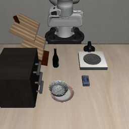
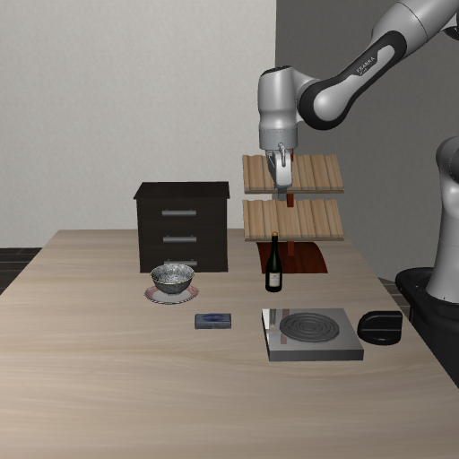

# 保存画面校准：局部修复，整体未通过

碗与盘子的识别误判已在保存画面上修正；纯视觉的松手/退离判断仍不可靠，整体效果验收未通过，自动视觉收尾默认 **off**。

本轮只读取历史画面：初始化、回放、新VLA、辅助、归位和训练均为0，没有新视频。GPT负责核查、标签与验收，实际DeepSeek实现确定修改，worker机械应用和归档。

原检查器存在物体与时间语义缺口：内部别名中的颜色不等于渲染颜色；碗覆盖盘中央时仍可通过盘沿辨认支撑，炉圈也不能当餐盘。修复后逐图标注frame/view/time，判断当前状态，不要求画面重演此前松手或退离过程，也不自行添加最低观察时长或必须离开整个工作区的条件。实测夹爪位置同时提供标准开口参考；原2mm编码器否决保留，开放位置本身不能证明释放。标准答案、评分ROI和仿真真值均不传Qwen。这些修复不证明所有失败都由提示词导致。

最终保留vision源码SHA为`05a2967845abc2b8e12e15f039ccf08ae9fd578fbc00fe4129c4caa800c8cb6e`，只比较该版本的同源记录：

| 保存状态 | 原始视觉 | 融合编码器后 | 独立验收 |
| --- | --- | --- | --- |
| [碗已放盘并退远](saved_checks/bowl_final_home_v3.json) | complete | complete | 正确；两视角餐具定位通过 |
| [碗到位但仍持有](saved_checks/bowl_initial_held_v2.json) | unknown | needs_release | 融合正确；不是纯视觉通过 |
| [酒瓶在架、手未确认退离](saved_checks/wine_exit_last.json) | complete | complete | 错误；不应完成 |

两种碗状态只说明这两份冻结输入上的能力，不能当可靠性成功率。酒瓶旧记录没有同时间编码器，不从不同时间的末态补数值。灶台、汤罐、番茄酱三组已准备但未调用，本轮不能称六例全部测完或通过。

全部9次Qwen探索均保留，共27,806 tokens。加强指尖规则后酒瓶变为保守unknown，但已完成的碗正例也退化unknown；最后一次尺度澄清仍失败，按停止规则撤回这两条候选提示，没有继续下游物理验证。unknown是拒绝或证据不足，不能计准确成功。实际DeepSeek共12调用，51,865输入/21,919输出tokens，含截断和接口失败记录；调用数量不是成果证明。详见[最终保留版本](evidence/retained_revision.json)、[模型调用来源](evidence/model_calls.json)和[失败候选源码](evidence/failed_finger_vision.py)。

软件接口已接通：最终视觉42项、runtime10项、service集成5项、launcher16项通过；原169项suite有1个launcher fixture失败后修复，Node的缓存视频与停止测试通过。软件结论来自[保存的检查输出](evidence/software_ui_validation.json)及各修复验收记录，初稿失败和修复结果均保留。service/runtime/app接入和状态展示完成，真实物理闭环没有验证；[自动收尾默认关闭](evidence/default_disabled.json)，服务未启动。control、sensors、joint_home、geometry旧实现保持，不用重新归位掩盖检查器失败。

复核入口：[evaluate_saved.py](evaluate_saved.py)；[冻结画面清单](evidence/fixtures.json)、[独立标签](evidence/labels_review.json)、[源码快照](source_snapshot.zip)、[快照SHA清单](evidence/source_snapshot_manifest.json)及[零物理分析方案](../../plans/2026-10-10-vision-grounding.json)。当前应保留关闭状态，先解决酒瓶与指尖可见性的误判；本轮未验证自动收尾在更多物体或组合任务上的效果。

下图是历史最终原帧，没有裁剪、重建或生成新demo：

