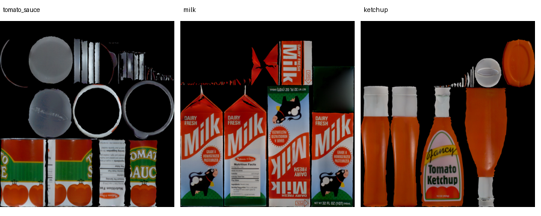

# 600步容器试点：检查语义已纠正，两个任务仍未完成

本轮解决了150步“未知”就停止和300步预算终止的问题。两个原生场景各运行一次，实际均执行600个VLA动作，150／300／450／600步的现场检查均返回false，没有误触发松手。番茄酱没有入篮；黄白杯最终在微波炉外台面，关门未启动。没有达到收尾接管的正例状态，因此本轮没有验证新场景的收尾和归位效果。

## 先说清物体身份

用户截图中标有Milk的纸盒确实是牛奶。安装版LIBERO场景同时包含三个不同物体：

| 原生物体 | 外观 | 当前子任务的目标 |
|---|---|---|
| `milk_1` | 红白绿纸盒，Milk文字 | 否 |
| `tomato_sauce_1` | 红绿标签的圆柱罐头，Tomato Sauce文字 | 是 |
| `ketchup_1` | 后面的橙色挤压瓶，Tomato Ketchup文字 | 否 |

`tomato_sauce`和`ketchup`在中文里容易都被称为番茄酱，但LIBERO把它们定义为两件不同物品。当前试验沿用原生番茄酱**罐头**入篮目标。详见[native_basket.bddl](native_basket.bddl)和[物体来源核查](object_identity.json)。

实际策略请求文本是`put the tomato sauce in the basket`；新试点600次策略输入均记录了这个文本，没有切换为milk。它仍在牛奶盒附近操作并抓错物体，说明本次执行没有正确对应指令中的目标。此证据不能独自确定是训练数据、语言泛化还是其他底层适配问题。

Qwen物体识别也尚未可靠：第300、450、600步的理由把牛奶盒误称为“番茄酱罐被夹持”。虽然这几次goal_achieved=false，没有误触发收尾，但不能由此声称目标识别已经修好。需要将**目标是否到位**与**物体身份是否认对**分别验收。

## 本轮改了什么

- 检查器根据当前子任务辨认指定物品，不以正在抓的物品替代目标。原生资产外观说明只提供身份含义，不提供当前位置或仿真真值。
- 明确true为已达到目标、false为看见目标未达到、null为确实无法辨认。一个视角明确显示未到位，另一个视角遮挡，不应因此返回null。理由与布尔值须一致。
- 每150个实际VLA动作检查，单个子任务上限600。有效null在预算用完前不松手、不终止，继续到下个检查点；600步仍null则停止。程序或同步反馈异常仍停止。
- 服务默认和MCP提交／修复预算均改为600，Hermes预算说明同步更新。保留原2000步会话总限制。本轮使用独立试点服务，没有重启用户演示服务或开启新的界面自动收尾配置。
- 收尾、反馈退离、路径保护、标准关节归位源码与上一轮一致，见[源码比较](downstream_source_comparison.json)。没有单独重跑归位、微调、回放、抓取辅助或子agent。

修改提交：`a39a6dd`。按最新“不用子agent”要求，由当前主会话及本地命令执行；没有低推理模型或DeepSeek调用，也不声称人为切换了主会话推理档位。

## 验证结果

保存的番茄150步、杯子150步和300步三个负例，仅在提示词改变后各复核一次，均返回false，零机器人动作。保存[原始新请求与响应](saved_negatives/)和[结果](saved_negative_summary.json)，没有修改历史null记录。软件验证241项通过；[MCP预算探针](mcp_budget_probe.json)使用实际MCP解释器确认提交和修复均发送600，零网络／机器人动作。

| 实际流程 | 新VLA动作 | 检查点和结果 | 原生目标为真的采样 | 收尾／归位实际动作 | 结论 |
|---|---:|---|---:|---:|---|
| 番茄酱罐入篮 | 600 | 150、300、450、600：均false | 0/600 | 0 | 仍未入篮，存在牛奶误抓及Qwen持物身份误认 |
| 黄白杯入炉→关门 | 600（杯子）；0（关门） | 杯子四次均false | 杯子0/600 | 0 | 杯子最终在炉外台面；前置任务失败，关门未验证 |

两个流程均以`budget_exhausted`结束，不是150步未知或300步上限导致停止。零收尾是目标未达到时的拒绝接管，**不能解释成收尾器或归位又失败了**。

杯子的掉落发生在VLA执行期间：本例全部600个环境动作来源均为VLA，没有收尾器松手动作。见[动作来源与阶段诊断](mug_action_diagnostic.json)。

新试点前缀与上一轮逐项相同：番茄前150、杯子前300个实际动作和原生目标序列一致，初始状态SHA相同。见[番茄对比](sauce_prefix_comparison.json)、[杯子对比](mug_prefix_comparison.json)。这证明确实补充了旧停止点以后的执行；不是分离提示词和预算贡献的单因素对照，也不是可靠性统计。

现场Qwen8次、17,568tokens；保存画面复核3次、6,365tokens；本轮合计11次、23,933tokens。新VLA动作1,200，收尾／归位／回放／抓辅动作均0。[完整汇总](summary.json)核对了两张输入图SHA、采样时刻和夹爪反馈匹配；原始完整提示词及响应在各任务的`finish/model_requests`中，展示最终回答，不引用模型推理过程。

## 新视频

每个VLA动作一帧，20fps，600步约30秒，不包含模型等待；四个检查点约在7.5、15、22.5、30秒。原始录像和逐步动作保留，没有把旧视频充作本轮结果。

接下来应优先定位**拿对指定物品**和**杯子到位前的控制失败**。延长预算已经得到实际证据，继续重复归位或直接微调都不能回答这两个问题。本轮不新增训练，也不将目标识别视作已解决。
